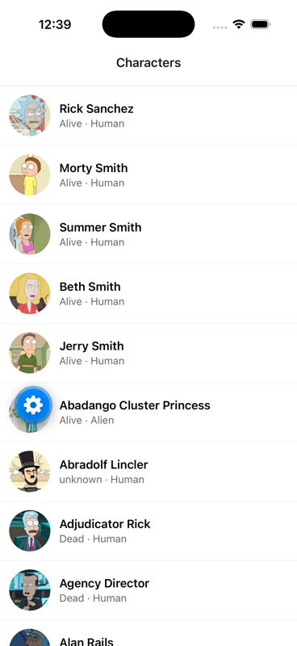

# supahiro

A small React Native (Expo) app built for the Zuvomo React Native Developer take-home.
It lists characters from the public [Rick and Morty API](https://rickandmortyapi.com/), opens a detail screen on tap, and handles loading, error and pull-to-refresh states.



## Features

- **List screen** – fetches `GET /api/character` and shows avatar, name, status and species in a `FlatList`.
- **Detail screen** – tap a row to push a native-stack screen with the full character info (status, species, gender, origin, last known location).
- **Loading state** – full-screen spinner on first load.
- **Error state** – error message with a **Retry** button. If a pull-to-refresh fails while data is already showing, a banner appears above the list instead of wiping it.
- **Pull-to-refresh** – native refresh control on the list.

## Run it

Requirements: Node 20+ and either the **Expo Go** app on your phone, or an iOS Simulator / Android emulator.

```bash
npm install
npx expo start
```

Then press `i` for iOS Simulator, `a` for Android emulator, or scan the QR code with Expo Go.

## Checks

```bash
npm test           # jest – API client tests
npm run typecheck  # tsc --noEmit
```

## Structure

```
App.tsx                      navigator: List -> Detail
src/api.ts                   fetchCharacters() + Character type
src/navigation.ts            stack param list types
src/screens/ListScreen.tsx   list, loading, error, pull-to-refresh
src/screens/DetailScreen.tsx character details
src/__tests__/api.test.ts    API client tests
src/__tests__/App.test.tsx   list -> detail flow and error state tests
```

Stack: Expo SDK 57, React Native 0.86, TypeScript, React Navigation (native stack), jest-expo.
